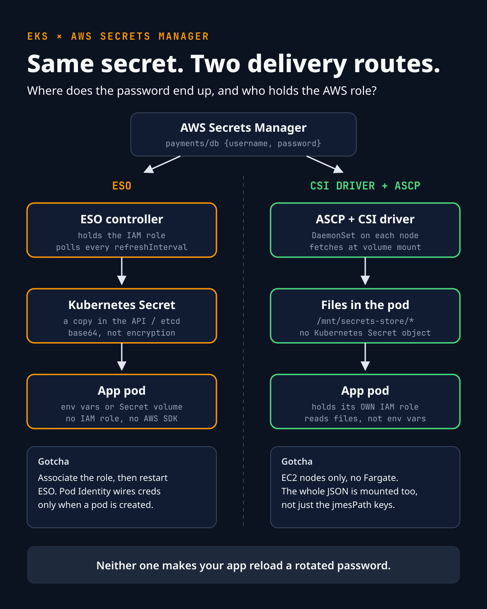

In my [last post](https://github.com/nazmur96/devops-sre-authentication/blob/main/posts/eso-eks-pod-identity.md)
an app in EKS read a database password from AWS Secrets Manager through
**ESO** (External Secrets Operator). The app just read a normal Kubernetes
Secret, and ESO filled it in.

ESO is not the only way. The other common one is the **Secrets Store CSI
Driver** with the **AWS provider (ASCP)**. Both get the same secret into the
same pod. They differ in two things that matter:

1. **Where the password ends up:** a Kubernetes Secret, or files inside the pod.
2. **Who holds the AWS permission:** one controller, or each app.



## The analogy, continued

Secrets Manager is still the bank vault.

- **ESO is a courier.** One courier has the permission slip (IAM role). It
  picks up the cash and puts it in a locker inside your building (a Kubernetes
  Secret). Anyone with the locker key can open it. Your app doesn't need a
  slip.
- **CSI is direct delivery to a desk.** Each employee (pod) has their own
  permission slip. When they sit down (the pod starts), the vault delivers a
  sealed envelope straight to their desk drawer (a mounted volume). There is
  no locker in the building.

## Side by side

| Question | ESO | CSI driver (files only) |
|---|---|---|
| Creates a Kubernetes Secret? | Yes | No (unless you turn on sync) |
| App reads it as | Env vars or Secret volume | Files in a mounted directory |
| Who holds the IAM role | The ESO controller | Each app's ServiceAccount |
| When it fetches | Every `refreshInterval` | At pod start, then optional rotation polling |
| Runs on Fargate? | Yes (ESO is a normal Deployment) | No, ASCP is a DaemonSet (EC2 nodes only) |
| Typical fit | Apps already built around K8s Secrets / env vars | Apps that can read files, and teams that don't want a copy in etcd |

The one-liner:

```text
ESO:  AWS → ESO controller → Kubernetes Secret → Pod
CSI:  AWS → ASCP + CSI driver → files in the pod
```

## Which one should you pick?

- App already reads `DB_PASSWORD` from an env var or a Secret → **ESO**.
- You want one place that syncs many secrets into many namespaces → **ESO**.
- You don't want a copy of the password in the Kubernetes API / etcd, and the
  app can read a file → **CSI**.
- Each app should hold its own narrowly-scoped IAM role → **CSI**.
- Running on Fargate → **ESO** (ASCP doesn't run there).

It's a per-workload choice, not a religion. One thing to watch: CSI has an
optional "sync as Kubernetes Secret" feature. Turn it on and you've got the
etcd copy back, so you've lost the main reason to pick CSI.

A reminder for both: a Kubernetes Secret is base64, not encrypted. If you use
ESO, turn on etcd encryption at rest and keep RBAC on Secrets tight. If you use
CSI, the mounted file is still the password; it's just not in etcd.

---

# Hands-on: CSI driver + ASCP with Pod Identity

The ESO walkthrough is in the
[previous post](https://github.com/nazmur96/devops-sre-authentication/blob/main/posts/eso-eks-pod-identity.md).
This is the CSI version for the same kind of secret.

**Prerequisites:** an EKS cluster with **EC2 nodes**, the EKS Pod Identity
Agent add-on installed, and `aws`, `kubectl` and `helm` configured.

### Step 0: Variables

```bash
export CLUSTER_NAME=my-cluster
export AWS_REGION=eu-central-1
export ACCOUNT_ID=$(aws sts get-caller-identity --query Account --output text)
```

### Step 1: The secret in AWS

```bash
aws secretsmanager create-secret \
  --name payments/db \
  --region $AWS_REGION \
  --secret-string '{"username":"payments_app","password":"CHANGE_ME"}'
```

### Step 2: Install the CSI driver

Pod Identity needs the driver to request service-account tokens for **two**
audiences. Miss the second one and mounts fail with an auth error.

```bash
helm repo add secrets-store-csi-driver \
  https://kubernetes-sigs.github.io/secrets-store-csi-driver/charts
helm repo update

helm upgrade --install csi-secrets-store \
  secrets-store-csi-driver/secrets-store-csi-driver \
  --namespace kube-system \
  --set "tokenRequests[0].audience=sts.amazonaws.com" \
  --set "tokenRequests[1].audience=pods.eks.amazonaws.com" \
  --set enableSecretRotation=true \
  --set rotationPollInterval=3600s
```

AWS recommends a one-hour poll interval. Shorter intervals mean more
Secrets Manager API calls, and those cost money.

### Step 3: Install the AWS provider (ASCP)

```bash
helm repo add aws-secrets-manager \
  https://aws.github.io/secrets-store-csi-driver-provider-aws
helm repo update

helm upgrade --install secrets-provider-aws \
  aws-secrets-manager/secrets-store-csi-driver-provider-aws \
  --namespace kube-system \
  --set secrets-store-csi-driver.install=false
```

`install=false` stops the ASCP chart from installing a second copy of the
driver, because we installed it ourselves in Step 2. (The other way is to skip
Step 2 and let the ASCP chart install the driver. Just don't do both.)

### Step 4: An IAM role for the **app**

This is the big difference from ESO: the role belongs to the app.

```bash
cat > trust-policy.json <<EOF
{
  "Version": "2012-10-17",
  "Statement": [{
    "Effect": "Allow",
    "Principal": { "Service": "pods.eks.amazonaws.com" },
    "Action": ["sts:AssumeRole", "sts:TagSession"]
  }]
}
EOF

cat > permissions-policy.json <<EOF
{
  "Version": "2012-10-17",
  "Statement": [{
    "Effect": "Allow",
    "Action": ["secretsmanager:GetSecretValue", "secretsmanager:DescribeSecret"],
    "Resource": "arn:aws:secretsmanager:${AWS_REGION}:${ACCOUNT_ID}:secret:payments/db-*"
  }]
}
EOF

aws iam create-role --role-name payments-api-secrets \
  --assume-role-policy-document file://trust-policy.json
aws iam put-role-policy --role-name payments-api-secrets \
  --policy-name read-payments-db \
  --policy-document file://permissions-policy.json
```

The `-*` covers the random suffix AWS adds to every secret ARN. If the secret
uses a customer-managed KMS key, also allow `kms:Decrypt` on that key.

### Step 5: ServiceAccount + Pod Identity association

```bash
kubectl create namespace payments
kubectl create serviceaccount payments-api -n payments

aws eks create-pod-identity-association \
  --cluster-name $CLUSTER_NAME \
  --namespace payments \
  --service-account payments-api \
  --role-arn arn:aws:iam::${ACCOUNT_ID}:role/payments-api-secrets
```

The app pod doesn't exist yet, so no restart is needed here. That's not true
for ESO; see the gotchas below.

### Step 6: SecretProviderClass (which secret, which filenames)

```yaml
# secret-provider-class.yaml
apiVersion: secrets-store.csi.x-k8s.io/v1
kind: SecretProviderClass
metadata:
  name: aws-payments-db
  namespace: payments          # must be the pod's namespace
spec:
  provider: aws
  parameters:
    region: eu-central-1
    usePodIdentity: "true"
    objects: |
      - objectName: "payments/db"
        objectType: "secretsmanager"
        jmesPath:
          - path: "username"
            objectAlias: "DB_USERNAME"
          - path: "password"
            objectAlias: "DB_PASSWORD"
```

```bash
kubectl apply -f secret-provider-class.yaml
```

### Step 7: Mount it in the app

```yaml
# app.yaml
apiVersion: apps/v1
kind: Deployment
metadata:
  name: payments-api
  namespace: payments
spec:
  replicas: 1
  selector:
    matchLabels: { app: payments-api }
  template:
    metadata:
      labels: { app: payments-api }
    spec:
      serviceAccountName: payments-api
      containers:
        - name: payments-api
          image: busybox
          command: ["sh", "-c", "echo started; sleep 3600"]
          volumeMounts:
            - name: db-secrets
              mountPath: /mnt/secrets-store
              readOnly: true
      volumes:
        - name: db-secrets
          csi:
            driver: secrets-store.csi.k8s.io
            readOnly: true
            volumeAttributes:
              secretProviderClass: aws-payments-db
```

```bash
kubectl apply -f app.yaml
kubectl exec -n payments deploy/payments-api -- ls /mnt/secrets-store
```

You'll see **three** files, not two:

```text
DB_PASSWORD
DB_USERNAME
payments_db
```

`payments_db` is the whole JSON secret. ASCP mounts the full object as well as
the `jmesPath` keys, and turns the `/` in the name into `_`. So the
"only the password" idea doesn't hold: the username and password are both in
that file. Lock down `exec` access accordingly.

## Gotchas (both tools)

**1. ESO + Pod Identity: restart ESO after creating the association.**
Pod Identity injects credentials into a pod only when the pod is *created*.
The usual order is "helm install ESO, then create the association", and that
leaves the running ESO controller with no AWS credentials. Your
ClusterSecretStore goes not-ready with a credentials or AccessDenied error.
Fix:

```bash
kubectl rollout restart deploy/external-secrets -n external-secrets
```

Or create the association before the Helm install. The CSI walkthrough above
avoids this only because the app pod is created after its association.

**2. Private clusters: Pod Identity uses `eks-auth`, not STS.**
A lot of guides say "make sure the cluster can reach STS". That's the IRSA
path. With Pod Identity, the agent on each node gets credentials from the
**EKS Auth API**. In a private cluster with no NAT you need interface VPC
endpoints for:

- `com.amazonaws.<region>.eks-auth`: Pod Identity credentials
- `com.amazonaws.<region>.secretsmanager`: the secret itself
- `com.amazonaws.<region>.kms`: only with a customer-managed key
- `com.amazonaws.<region>.sts`: only if you use IRSA instead

**3. Lock down a ClusterSecretStore.** A ClusterSecretStore with no
restrictions lets *any* namespace that can create an ExternalSecret read
*anything* the ESO role can read. Use `spec.conditions` with a
`namespaceSelector`, or a namespaced `SecretStore` per team.

**4. Nobody reloads your app.** ESO updates the Kubernetes Secret and CSI
updates the file. Env vars never change in a running process. Mounted files
change, but your DB client won't notice unless it re-reads them. Watch the
file, use something like Reloader, or do a controlled rollout.

## Troubleshooting

| Symptom | Look here |
|---|---|
| ExternalSecret / ClusterSecretStore not ready, AccessDenied | `kubectl describe clustersecretstore …`; restart ESO if the association came after it started; check the association's namespace and SA name |
| CSI pod stuck in `ContainerCreating` | `kubectl describe pod`: mount events usually name the exact error |
| CSI mount auth error | Both `tokenRequests` audiences set? `usePodIdentity: "true"`? Association on the pod's SA? |
| CSI provider not found | `kubectl get pods -n kube-system`: is the ASCP DaemonSet on that node? (Fargate: it can't be) |
| File missing | SecretProviderClass in the pod's namespace? `objectName`, `jmesPath`, `secretProviderClass` name all spelled right? |
| Works in public subnets, times out in private | VPC endpoints from gotcha 2 |

## Cleanup

```bash
kubectl delete namespace payments
helm uninstall secrets-provider-aws -n kube-system
helm uninstall csi-secrets-store -n kube-system
aws eks delete-pod-identity-association --cluster-name $CLUSTER_NAME \
  --association-id <id-from-list-pod-identity-associations>
aws iam delete-role-policy --role-name payments-api-secrets --policy-name read-payments-db
aws iam delete-role --role-name payments-api-secrets
aws secretsmanager delete-secret --secret-id payments/db --force-delete-without-recovery
```

## References

- [AWS: ASCP for EKS](https://docs.aws.amazon.com/secretsmanager/latest/userguide/ascp-eks-installation.html)
- [ASCP README](https://github.com/aws/secrets-store-csi-driver-provider-aws)
- [EKS Pod Identity associations](https://docs.aws.amazon.com/eks/latest/userguide/pod-id-association.html)
- [ESO AWS authentication](https://external-secrets.io/latest/provider/aws-access/)
- [Secrets Store CSI Driver](https://secrets-store-csi-driver.sigs.k8s.io/)
